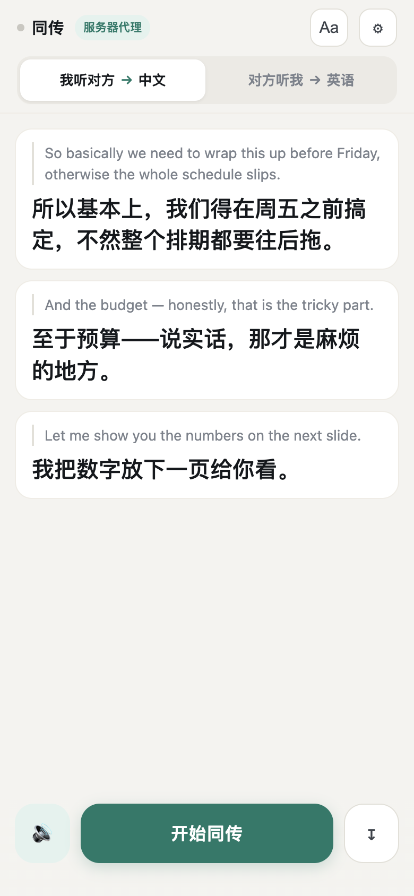

# 同传 · 给国行 AirPods 补上实时翻译

一句话原理：**手机麦克风/耳机麦克风收外语 → DeepSeek 翻译 → 系统语音念出来**。国行 AirPods 缺的是 Apple Intelligence 那层，这条链路绕开了它。



**适合谁**：iPhone + AirPods，想要面对面实时翻译，但国行机型没有 Apple 的「实时翻译」。不用越狱、不用签名安装、不用买硬件，一个网页就够。

| 需要什么 | 说明 |
|---|---|
| iPhone | iOS 14.5+（要 `webkitSpeechRecognition`），Safari 打开 |
| 耳机 | 任意蓝牙耳机都行，AirPods 只是最顺手 |
| DeepSeek API Key | [申请地址](https://platform.deepseek.com/)，按量计费，一次对话几分钱 |
| 服务端 | 没有也能跑：Mac 本机起服务 + 局域网访问即可 |

**不是什么**：不是原生 App、不能双方各听各的语言、不能离线用。详见下面的「物理限制」。

---

## 先跑起来：三种方式，从最快到最正式

| 方式 | 耗时 | 适不适合天天用 | 命令 |
|---|---|---|---|
| **① Mac 本机（今天就能试）** | 1 分钟 | 临时验证 | 双击 `start.command` |
| **② 加公网隧道（https，手机 4G 也能开）** | 3 分钟 | 短期凑用，网址会变 | 另开终端跑 `./tunnel.command` |
| **③ 云服务器（正式）** | 10 分钟 | 适合，网址固定 | `bash deploy.sh --domain 你的域名` |

**① 最快**：双击 `start.command`，它会在电脑上问一次 Key（**这样手机就不用输那 50 位**），然后把 Key 存进 `.env`，并打印一个局域网地址，比如 `http://你的电脑IP:8787`。手机连同一个 Wi-Fi 打开就行。

> 但 http 下 iOS 有时不给语音识别权限。打开后**先跑 `/selftest.html`**，第 5 项（麦克风实测）能识别就说明能⽤；不能就换 ②。

**② 要 https 时**：先 `brew install cloudflared`，然后保持 ① 的服务开着，另开一个终端：

```bash
./tunnel.command
```

它会打印一个 `https://xxx.trycloudflare.com` 的网址，手机打开即可（不用同一个 Wi-Fi，4G 也行）。关掉终端网址就失效——只适合测试。

**③ 长期用**：见 `DEPLOY.md`，或者直接看 `deploy.sh` 顶部的用法注释。

> 安全边界：服务端只对外发 `.html/.css/.png/.svg/.webmanifest` 和 `manifest.json`。`.env`、脚本、文档一律 404（含各种目录穿越写法）。所以 Key 放在服务器环境变量或本地 `.env` 里是安全的——但如果哪天你把整个目录丢到别的静态托管（比如 GitHub Pages）上，先确认没有 `.env` 跟着传。

---

## 怎么用（每次三步）

1. Safari 打开网址，点「开始同传」，允许麦克风
2. 手机放在你和对方之间，**麦克风那侧朝对方**
3. 按谁在说话切上面那个开关

---

## 声音走哪条路（关键）

iPhone 同一时刻**只有一个音频出口**，网页没法自己切，所以出口要跟着模式走：

| 模式 | 音频出口 | 你要做的 | 效果 |
|---|---|---|---|
| **我听对方** | AirPods | 控制中心把输出选回 AirPods | 对方说外语 → **中文念进你耳朵** |
| **对方听我** | iPhone 扬声器 | 控制中心 → 播放卡片右上 AirPlay 图标 → 选 **iPhone** | 你说中文 → **英文从扬声器念给对方**，同时屏幕出大字幕 |

切换出口的地方：**控制中心 → 右上角播放卡片 → 那个 AirPlay 图标**。点两下的事，而且只在换人说话时做一次。

> 为什么「对方听我」切走 AirPods 你没损失：你自己说的中文你当然懂，不需要翻译。这一步反而解决了我最初以为的死结。

**如果懒得切**：关掉设置里的「对方听我时用外放」，就只走大字幕——屏幕翻转 180°，对方从对面看是正的，一样能沟通，只是他得盯着屏幕。

---

## 两个必须满足的前提

1. **必须用 Safari 打开，不能"添加到主屏幕"后当独立 App 用**。iOS 在独立 Web App 模式里不开放语音识别（WebKit 至今没修）。加到主屏幕当书签可以，但会跳回 Safari 打开。
2. **Siri 必须开启**（设置 → Siri 与搜索）。关掉的话语音识别直接报错。

---

## 延迟大概多少

正常说话、停顿处触发：**1–1.5 秒**出声。

- 打开「抢译」后，听到逗号级停顿就先译前半句，长句子不用等说完
- 关掉「抢译」更完整但更慢
- 对方语速快、句子长时，延迟会累积到 2 秒左右

---

## 物理限制（改不了，只能适应）

- **AirPods 麦克风波束朝你的嘴**，隔 1 米以上收对方的声音会明显衰减 → 面对面尽量近一点，或者侧过身让耳机那侧朝他。
  注意：Apple 原生可以"把 iPhone 凑近对方"来借用手机麦克风，**网页做不到**——语音识别只有一条输入通道，连着耳机时就是耳机麦克风。所以别在手机上使劲，让人靠近。
- **耳机模式：先试降噪，跟不上再换通透。** Apple 原生是开 ANC 主动压低对方原声，逼你专心听译文；但它的翻译延迟低。我们这个有 1 秒多延迟，全降噪容易让人心里没底、忍不住抢话——试试哪种更适合你。
- 安静的房间里效果最好；嘈杂环境识别率会掉。

---

## 排错

| 现象 | 原因 / 处理 |
|---|---|
| 点「开始同传」没反应 | 主屏幕独立模式；或 Siri 没开 |
| 屏幕上冒出重复句 | 打开设置里「回声防护」；或把音量调小 |
| 对方听不到声音 | 音频输出还是 AirPods。控制中心切到 iPhone |
| 只能听到半句就断 | nginx 开了 `proxy_buffering`，见 DEPLOY.md 第 3 步 |
| 翻译一次性整段蹦出 | 同上，流式被缓冲了 |
| 提示「API Key 无效」 | 服务器上的 Key 过期，或本地直连模式填错了 |
| 念完一句就再也不听了 | 设置里把「全双工 / 半双工」切成**半双工**。这是 iOS 上识别和朗读抢音频通道的典型症状 |
| 反复听到自己的译文、屏幕重复句 | 同上，切半双工；或打开「回声防护」 |
| 切到扬声器后一点声音没有 | 检查侧边静音开关和媒体音量；再确认输出真的选中了 iPhone |
| 切完输出后对方还是听不到 | 有些情况下切换要等 1–2 秒生效；重新点一次「开始同传」让它重建音频会话 |
| 用着用着识别不吭声了（切过 App 回来） | 应该会自动重建；如果没恢复，点一下「停止」再「开始」 |

**全双工 vs 半双工**：默认全双工（边念边听，最接近同传手感）。但 iOS 上朗读和识别同时跑容易互相打架——表现就是「念完一句就哑了」。切到半双工后，朗读期间主动暂停听、念完立刻恢复，牺牲几百毫秒换来稳定。真机上如果全双工稳，就别切。

---

## 文件

| 文件 | 作用 |
|---|---|
| `index.html` | 整个 App（单文件，无框架） |
| `selftest.html` | 真机自检，五步定位问题 |
| `start.command` | Mac 本地起服务（会在电脑上问 Key，免手机输） |
| `tunnel.command` | 给本机服务开临时公网 https（cloudflared） |
| `server.js` | 静态托管 + DeepSeek 反向代理，把 Key 留在服务器上 |
| `deploy.sh` | 云服务器一键部署（systemd + nginx + 证书） |
| `DEPLOY.md` | 部署的详细步骤与排错 |

---

## 成本

按 DeepSeek 的定价，一次翻译请求大约几十个 token（带上下文时更多）：

- 连续聊 1 小时，大概 **几分钱到一两毛钱**
- 只翻短句的场景（点菜、问路）几乎可以忽略

Key 放在服务端环境变量里时，前端拿不到，别人打开你的链接也烧不掉你的额度。

## 为什么用 DeepSeek 而不是本地模型

- 浏览器里跑不了 whisper 级别的大模型，本地部署得自己搭服务，失去「一个网页就能用」的意义
- DeepSeek 接口支持跨域，浏览器可以直连（不想搭服务端时也能用，Key 存手机本地）
- 中文表达质量比一般机器翻译好一截，这对「听外语」这个场景很关键

## License

[MIT](LICENSE)
